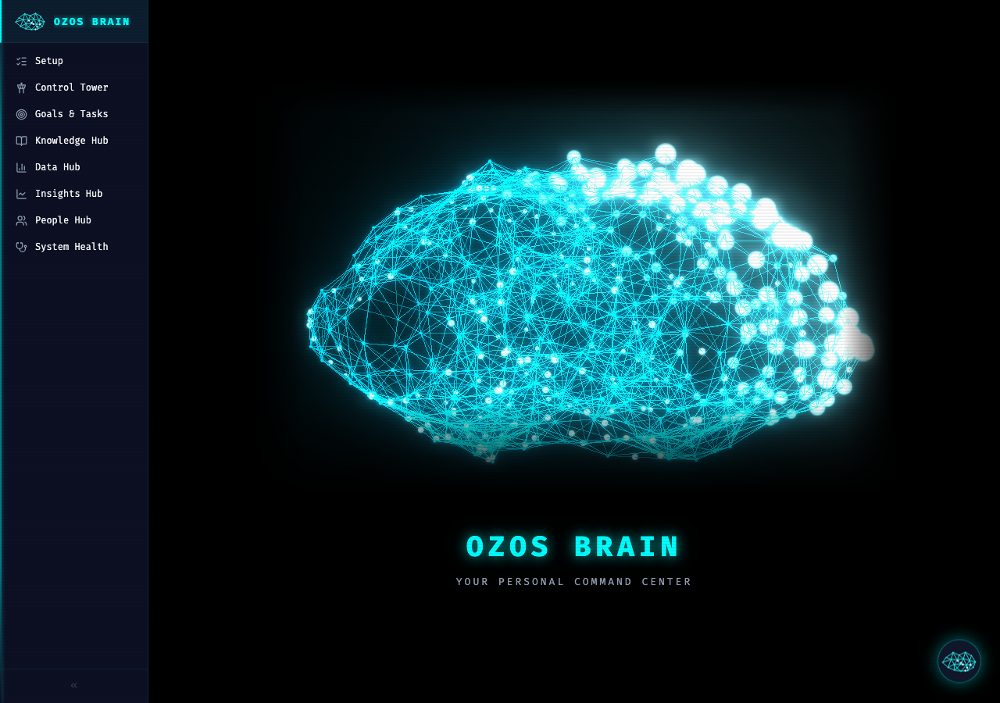
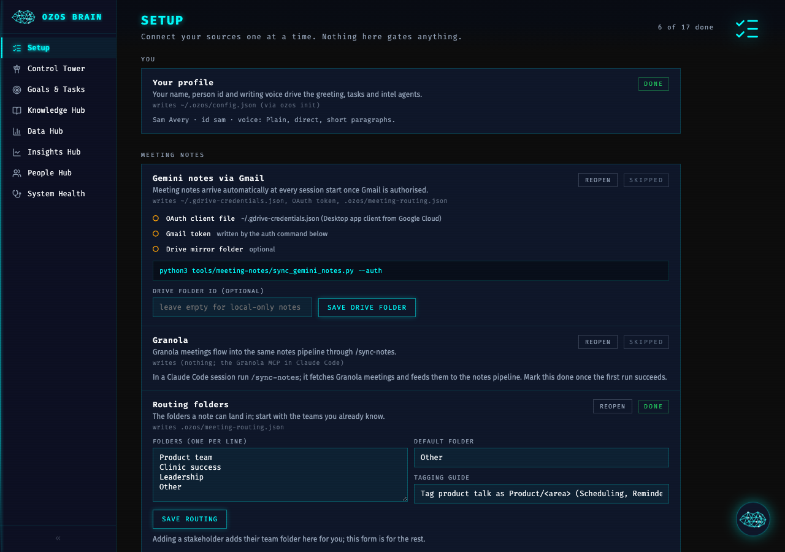
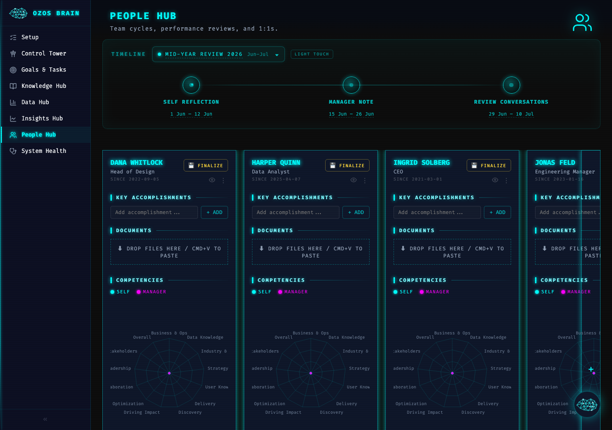
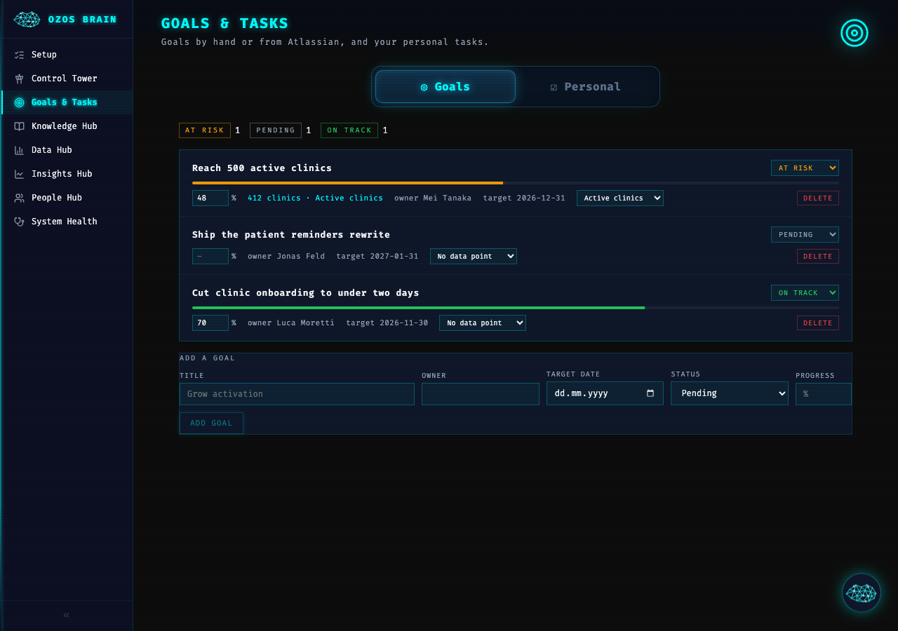
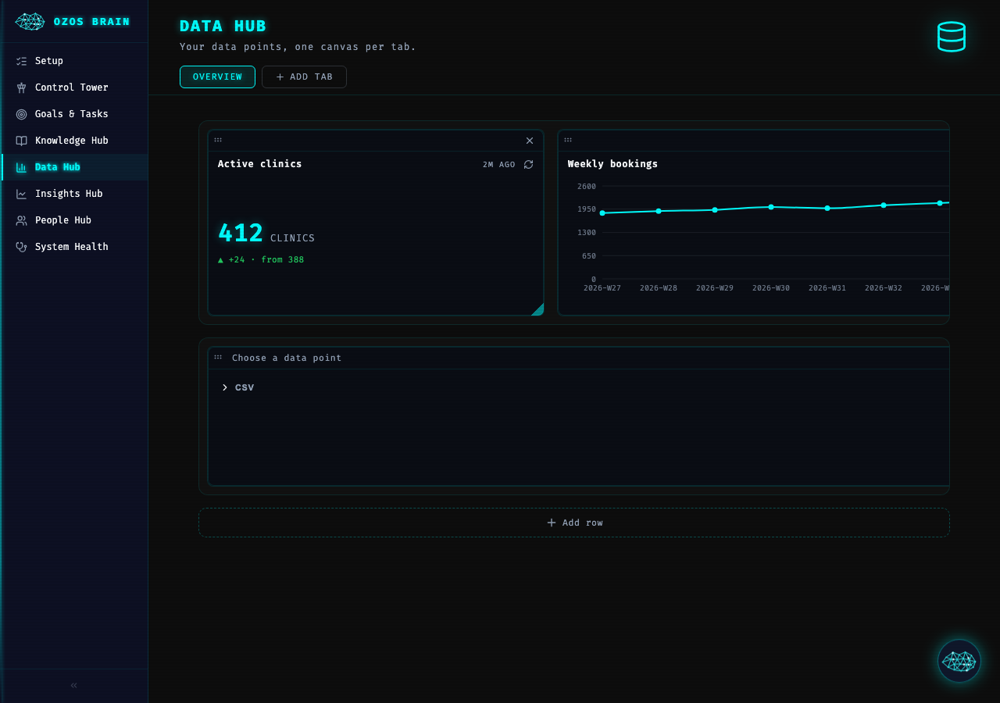
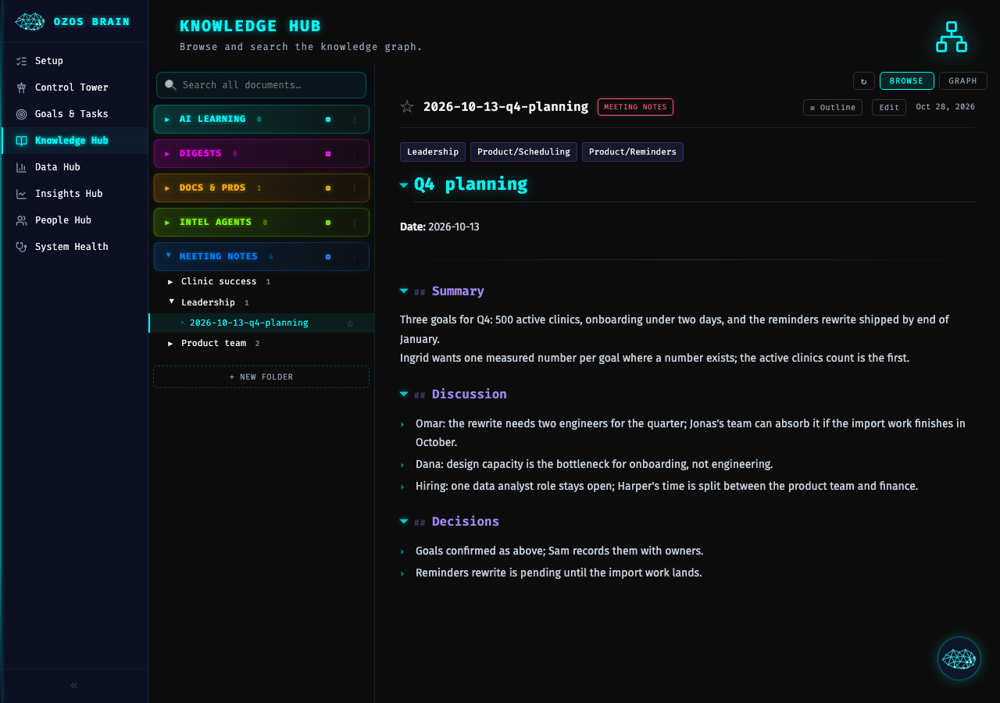

# OZOS Brain

OZOS is a personal operating system for product leaders, built on Claude Code. It is one
local brain for the people you work with, your meeting notes, your knowledge, your goals
and your numbers, with a chat that can read all of it. It is split into an **app** and a
**vault**, so when you change jobs you keep the app and start a new vault.

https://github.com/user-attachments/assets/d752f9cd-4c36-4aa4-b760-04267fc0b7da

## App + vault

```
┌───────────────────────────────┐          ┌──────────────────────────────────┐
│  engine  (this repo, public)  │          │  vault  (yours, one per company) │
│                               │  reads   │                                  │
│  app/        backend + UI     │ ───────▶ │  people-hub/     people YAML     │
│  tools/      notes, digests…  │  writes  │  knowledge-hub/  notes, learning │
│  connectors/ Metabase, Goals  │ ◀─────── │  .ozos/          config, goals,  │
│  skills/     Claude skills    │          │                  data points     │
│  vault-template/, vault-demo/ │          │  .env            credentials     │
└───────────────────────────────┘          └──────────────────────────────────┘
         the vault is found by: $OZOS_VAULT → ~/.ozos/config.json → ./vault
```

| | Engine (this repo) | Vault (yours) |
|---|---|---|
| Holds | app, tools, connectors, CLI, templates | people, meeting notes, knowledge, goals, data points, `.env` |
| Git | public-ready; `./ozos scrub-check` blocks company terms | a private repo, or just a folder |
| Where | wherever you clone it | `vault/` inside the engine by default, or anywhere you point it |

## Try it in two commands

```bash
git clone https://github.com/cozren/ozos-brain.git && cd ozos-brain
pip3 install -r requirements.txt && (cd app/frontend && npm ci)

./ozos init --demo      # a vault for Brightfold, a fictional clinic-scheduling company
bash app/run.sh         # backend on :8765, app on http://localhost:5173
```

You get seven invented people, three goals, two data points on a dashboard and four
meeting notes. Nothing in it is real. The chat needs an Anthropic key in the vault's
`.env`; everything else works without one.

## Start at your company

```bash
./ozos init             # your name, where the vault lives, your API key
```

Then follow **[docs/SETUP.md](docs/SETUP.md)**, the day-one guide: connecting sources one at
a time, adding people as you meet them, choosing a review cycle. Nothing has to be finished
in one sitting; the app runs fine half set up for weeks.

## A tour

### Home



The brain, and the way in. While setup is underway a **Setup: N of M done** badge sits
here until you dismiss it, and the default review cadence shows its next due dates. The demo
has finished setup, so it shows the quiet version.

### Setup



A grouped checklist of everything a company can feed into OZOS: meeting notes, chat and
workspace tools, boards, documentation, people, the review cycle, goals, data, insights.
Each item has a short form, writes one vault file, and can be done, skipped or reopened.
Nothing gates anything.

### People Hub



One card per person: role, accomplishments, documents, competencies, and the review cycle
timeline on top. Adding a stakeholder from Setup also routes their meetings into a folder of
their own.

### Goals



Goals by hand or pulled from Atlassian Goals, each with a status, progress and owner. Bind
a goal to a data point and the board shows the measured value beside it.

### Data Hub



Tabs of tiles. A tile shows a **data point**: a Metabase card, a SQL query against a SQLite
file, or a CSV in the vault, rendered as a number with a delta, a table or a line.

### Knowledge Hub



Every folder under the vault's `knowledge-hub/`: meeting notes routed by team and person,
digests, learning notes, documents. Tags, stars, search, and a graph view.

## Connectors

| Source | What it does | Guide |
|---|---|---|
| Gemini notes via Gmail | pulls meeting notes from Gemini emails, tags and routes them | [docs/connectors/gmail-gemini-notes.md](docs/connectors/gmail-gemini-notes.md) |
| Granola | the same for Granola meetings, through its MCP | [docs/connectors/granola.md](docs/connectors/granola.md) |
| Atlassian Goals | syncs goals onto the board | [connectors/atlassian-goals/setup.md](connectors/atlassian-goals/setup.md) |
| Metabase | saved questions as data points | [connectors/metabase/setup.md](connectors/metabase/setup.md) |
| Confluence | search from the chat | [connectors/atlassian-goals/setup.md](connectors/atlassian-goals/setup.md) |
| Slack, Google Workspace, Figma, Miro | through Claude Code MCPs; Setup shows which are connected | `/mcp` in Claude Code |

## Claude Code

OZOS is meant to be driven from a Claude Code session opened in the engine:

- **Skills and commands**: `/ozos-setup` works the next setup item with you, `/sync-notes`
  pulls meeting notes, `/ozos-brain` starts the app, `/daily-digest` and `/intel-run` run
  the agents, `/save-session` writes a session summary into the vault.
- **Hooks** in `.claude/settings.json`: notes sync and a knowledge-graph refresh at session
  start, the affected test suite after every edit.
- **Knowledge graph**: `graphify` indexes the engine and the vault together so the session
  can answer questions about people, meetings and decisions.
- **The chat** in the app is a Claude tool loop over the vault: people, notes, Confluence.

## Requirements

Python 3.12+, Node 20+, git, Claude Code and ripgrep. Optional: `graphify` for the
knowledge graph, Google Chrome for `app/run.sh` to open. An Anthropic API key, or the URL
and key of an Anthropic-compatible proxy from your employer (`OZOS_LLM_BASE_URL`).

## What works today

The engine runs against an empty vault or the demo. The Setup page, `/ozos-setup` and
`./ozos setup` are the living checklist for connecting sources, adding stakeholders and
choosing a review cycle, with a progress badge and cadence reminders on Home. Goals are
added by hand or pulled from Atlassian Goals and shown as a board. The Data Hub shows data
points from Metabase, SQLite or CSV as numbers, tables or lines on tiles you arrange in
tabs, refreshed by hand or daily, and bindable to a goal. Meeting notes arrive from Gemini
or Granola and are routed by team and person. Not here yet: renaming or deleting Data Hub
tabs from the page (edit `<vault>/.ozos/datahub.json`).

## Layout

```
app/              OZOS Brain — FastAPI backend + React/Vite frontend
tools/            generic tools (meeting-notes, daily-digest, intel-agents, youtube-xray, chatgpt-import, todo, test-pipeline, ozos-cli)
connectors/       optional clients a vault can enable (metabase, atlassian-goals)
skills/           shared Python (ozos_llm.py, ozos_vault.py, run_log.py) and Claude skills
vault-template/   seed for a new vault
vault-demo/       the fictional company behind ./ozos init --demo and the screenshots
docs/             the setup guide, engine plans, connector guides, README images
```

## Tests and formatting

TDD is mandatory; see [CONTRIBUTING.md](CONTRIBUTING.md). The whole suite:

```bash
python3 tools/test-pipeline/pipeline.py
cd app/frontend && npx tsc --noEmit && npx vitest run
```

The pre-commit hook blocks formatting drift, red tests, uncollected tests and any company
term found by `./ozos scrub-check`.

## Security

The engine never holds company data or credentials; those live in the vault and its `.env`.
[SECURITY.md](SECURITY.md) says what never goes here and how to report a leak.

## License

MIT — see [LICENSE](LICENSE).
